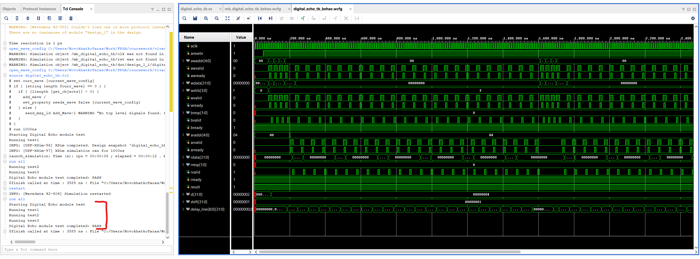
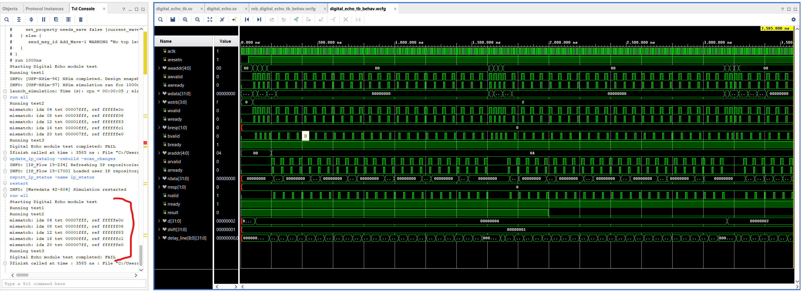
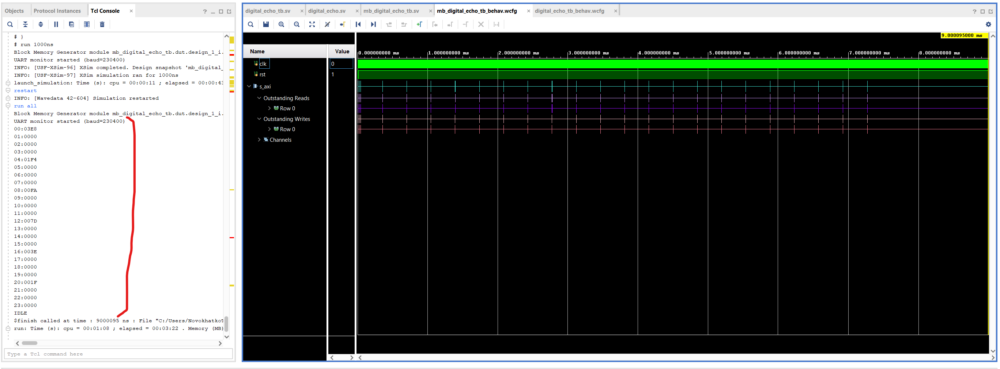
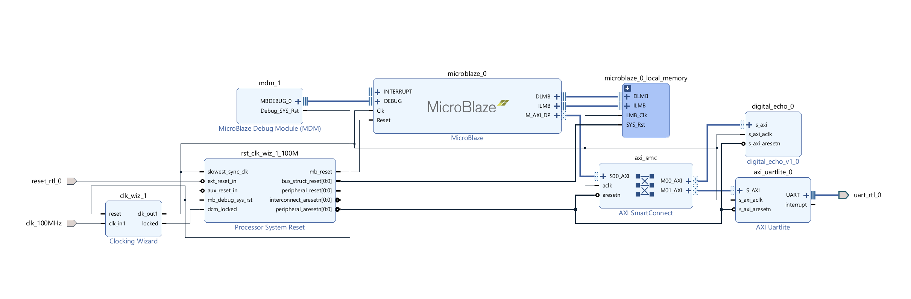
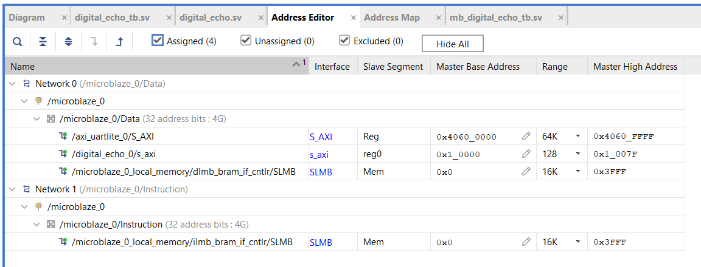
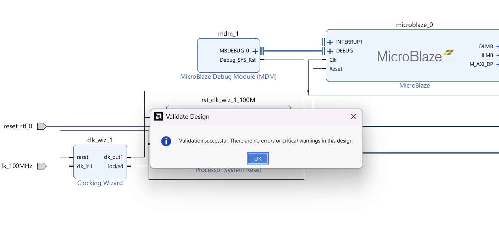
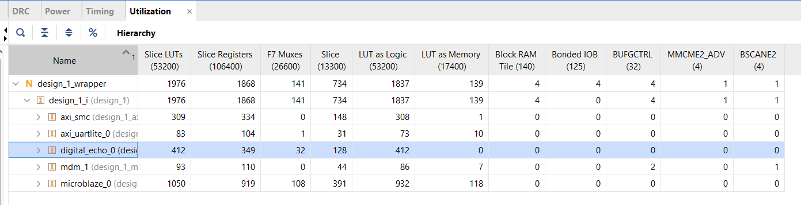
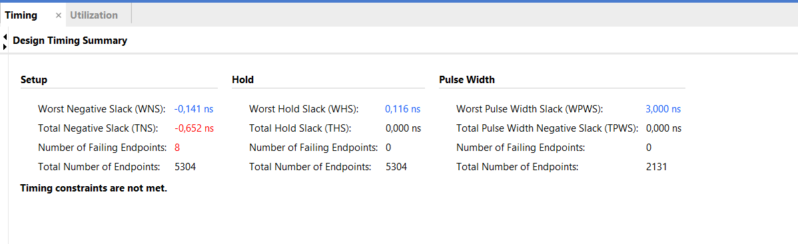
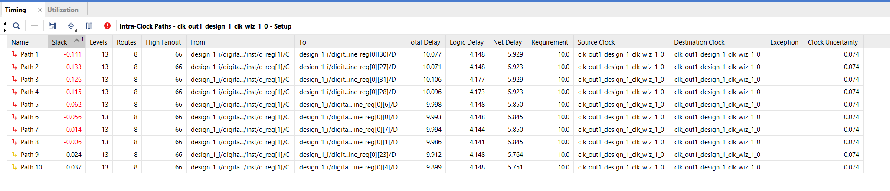

# Digital Echo

## Reproduction Steps

- Open Vitis IDE and import (`File -> Import`) [archive.zip](vitis/archive.zip) into the same folder similar to the way described in [homework_4](../homework_4/readme.md)
- Run `app_component` build, make sure it passed successfully ([app_component.elf](vitis/app_component/build/app_component.elf) file is generated) 
- Open [project_1.xpr](vivado/project_1/project_1.xpr) with Vivado
- Standalone module testing:
    - Make sure `Design Sources/digital_echo` and `Simulation Sources/digital_echo_tb` are set to be top modules
    - Run synthesis
    - Run behavioral simulation
    - Choose `digital_echo_tb_behav.wcfg` tab to display proper waveform
    - Check TCL console to contain verification results (should report `PASS`):
        
    - Comment out line 2 of [digital_echo.sv](vivado/digital_echo/digital_echo.sv) file to test how testbench behaves on errors
    - Rerun synthesis and behavioral simulation
    - Check TCL console to contain verification results (should report `FAIL`):
        
    - Revert back all changes in [digital_echo.sv](vivado/digital_echo/digital_echo.sv) for further testing
- MicroBlaze based system testing:
    - Make sure `Design Sources/design_1_wrapper` and `Simulation Sources/mb_digital_echo_tb` are set to be top modules
    - Run `Reports -> Report IP status` and check if all components are up-to-date
    - Run synthesis
    - Run behavioral simulation
    - Choose `mb_digital_echo_tb_behav.wcfg` tab to display proper waveform
    - Check TCL console to contain verification results (should contain 24 output samples from UART):
        
- Implementation
    - run implementation and generate bitstream

## Structure of the project

- [screenshots](screenshots) - folder with screenshots
- [vitis](vitis) - folder for Vitis project
    - [archive.zip](vitis/archive.zip) - archived Vitis project
    - [main.c](vitis/main.c) - main source file for Vitis project
- [vivado](vivado) - Vivado projects
    - [digital_echo](vivado/digital_echo) - `digital_echo` module IP
        - [digital_echo.sv](vivado/digital_echo/digital_echo.sv) - source code for digital echo module
    - [project_1](vivado/project_1) - main Vivado project
        - [digital_echo_tb.sv](vivado/project_1/project_1.srcs/sources_1/new/digital_echo_tb.sv) - testbench source for standalone module testing
        - [mb_digital_echo_tb.sv](vivado/project_1/project_1.srcs/sources_1/new/mb_digital_echo_tb.sv) - testbench source for testing with MicroBlaze based system

## Description

### 1. Digital echo module

**Source code**: [digital_echo.sv](vivado/digital_echo/digital_echo.sv)

Module implements digital echo according to [task 1](task.md#тема-1-цифрова-луна) variation `P` (no stream).

Module has AXI4-Lite interface with synchronization and reset inputs.

**Module parameters**:
| Name | Type | Default | Description |
|---|---|---|---|
| `AXI_DATA_WIDTH` | int | 32 | Width of AXI4-Lite data bus |
| `AXI_ADDR_WIDTH` | int | 5 | Width of AXI4-Lite address bus ($clog2(n_regs)+2) |
| `MAX_D_VALUE` | int | 8 | Max number of delay line entries |
| `MAX_SHIFT_VALUE` | int | 3 | Max right shift value |

Module works with 5 32-bit registers. Registers indexes are defined with `axi_reg_idx_e` enumeration. Register address offset is calculated as 4*idx, where idx is entry of `axi_reg_idx_e` enumeration. Enumeration defined inside `digital_echo_p` package for easy reuse in testbench.

**Module Registers**:
| Offset | Name | Enum Idx | Type | Description |
|---|---|---|---|---|
| 0x00 | `IN` | `AXI_REG_IDX_IN` | wr | Data input, 16-bit signed value, write initiates single step |
| 0x04 | `OUT` | `AXI_REG_IDX_OUT` | rd | Data input, 16-bit signed value, data available right after `IN` write |
| 0x08 | `D` | `AXI_REG_IDX_D` | wr/rd | Delay in steps, range [1 .. `MAX_D_VALUE`] |
| 0x0C | `SHIFT` | `AXI_REG_IDX_SHIFT` | wr/rd | Right shift, range [1 .. `MAX_SHIFT_VALUE`] |
| 0x10 | `CTRL` | `AXI_REG_IDX_CTRL` | wr | Control register: writing 1 resets inner memory |

Module consists of 3 `always_ff` blocks:
- AXI4-Lite bus write logic
- Registers write logic
- AXI4-Lite bus read logic

Source code of the module has `ARITHM_SHIFT` preprocessor definition. It enables arithmetic shift of delayed value (which corresponds to module requirements). Disabling it logical shift is activated instead, which could be used to test testbench for failures.

### 2. Standalone module testbench

**Source code**: [digital_echo_tb.sv](vivado/project_1/project_1.srcs/sources_1/new/digital_echo_tb.sv) 

Testbench for testing digital echo module.

Testbench consists of 3 tasks and main testing sequence:
- `axi_write` task - implements AXI4-Lite write event
- `axi_read` task - implements AXI4-Lite read event
- `single_test` task:
    - sets up module with `D` and `SHIFT` parameters
    - resets module with writing to `CRTL` register
    - initiates processing steps in a loop by writing and reading `IN` and `OUT` registers
    - compares `OUT` values with calculated reference and prints comparison info in case of mismatch
- main testing sequence - runs following tests and displays total result:
    - `D`=4, `SHIFT`=1, `IN`[0] = 1000, and repeats 0 for IN 23 times after first value
    - `D`=4, `SHIFT`=1, `IN`[0] = -1000, and repeats 0 for IN 23 times after first value
    - `D`=2, `SHIFT`=1, `IN` sequence: {30000, 0, 30000, 0, 0, 0}

### 3. MicroBlaze program

**Source code**: [main.c](vitis/main.c)

MicroBlaze program implements first test case from standalone main testing sequence (previous chapter).

Program sets up `D` and `SHIFT` parameters and runs 24 steps of processing. 

Output values are sent over UART interface with `xil_printf` function call.

### MicroBlaze based system testbench

**Source code**: [mb_digital_echo_tb.sv](vivado/project_1/project_1.srcs/sources_1/new/mb_digital_echo_tb.sv)

Testbench for whole system testing.

Testbench consists of 2 modules:
- `uart_monitor` - helps to read data from UART and prints it to simulation console
- `mb_digital_echo_tb` - main testing module, contain testing system and uart_monitor instanses, sets up `clk` and `rst` signals and waits 9ms to let UART transmit all expected data.

### 4. MicroBlaze based system design

Design consists of the folowing parts:
- MicroBlaze IP - runs simple testing code
- Digital Echo IP - target module
- AXI UART Lite IP - UART module for reading outputs in simulation
- Additional helping modules for interconnection, synchronization and control

Design main blocks are interconnected with AXI bus, and available for MicroBlaze program with following addresses: 

Design was validated with `Validate Design` Vivado feature:

### 5. Implementation

Implementation phase shows the following results:
- Utilization:

    
- Timing Summary:

    
- Timing Details:

    

As it can be seen from timing reports, target module didn't meet timing requirements (100 Mhz clock).
Bottleneck is d/delay_line indexing (line 119 of [digital_echo.sv](vivado/digital_echo/digital_echo.sv)).
Ways to fix it: rewrite code somehow (probably with pipelining) or decrease system clock frequency.