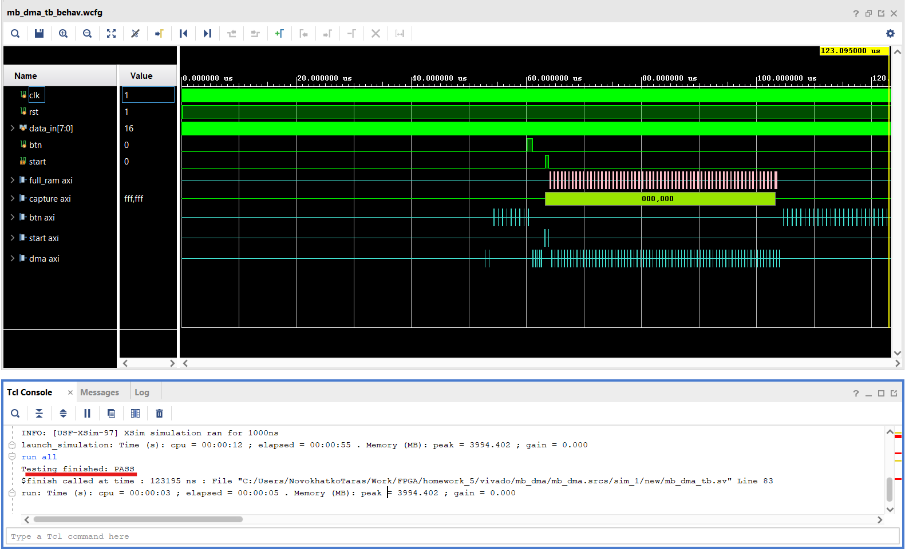
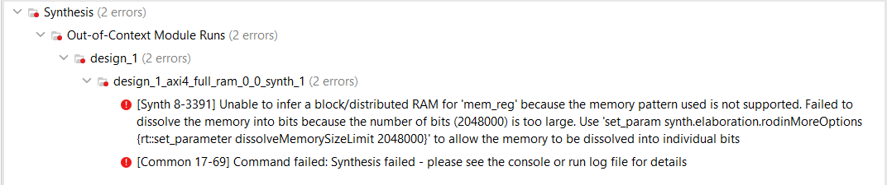

# DMA

## Reproduction Steps

- Open Vitis IDE and import (`File -> Import`) [archive.zip](vitis/archive.zip) into the same folder similar to the way described in [homework_4](../homework_4/readme.md)
- Run `app_component` build, make sure it passed successfully ([app_component.elf](vitis//app_component/build/app_component.elf) file is generated) 
- Open [mb_dma.xpr](vivado/mb_dma/mb_dma.xpr) with Vivado
- Run `Reports -> Report IP status` and check if all components are up-to-date
- Run synthesis
- Run behavioral simulation

## Results

Picture above shows the following subsequent events:
- DMA init on `dma axi`
- Polling the button on `btn axi`
- Start DMA transfer on `dma axi` right after `btn` strobe
- `start` strobe in parallel to `start axi` activity
- Data reads on `capture axi` right after `start` strobe
- Data writes on `full_ram axi` some time after `capture axi` activity start
- `DMA buzy` polling on `dma axi` all the time between `start` strobe and the end of `full_ram axi` activity
- Polling the button on `btn axi` after transfer complete

## Description

System consists of the following key components:
- `axi_byte_capture` module - recieves 8-bit data from outside and stores it to internal FIFO as 32-bit words by rising edge of `start` input signal. Module sends packed words over `AXI4-Stream` output with length of the stream predefined by `FRAME_WORDS` parameter
- `axi_full_ram` module - simple RAM module from DMA task example
- `axi_dma` module - configured to recieve data from `axi_byte_capture` module on `S_AXIS_S2MM` port and to send data to `axi_full_ram` module over `M_AXI_S2MM` port
- 2 `axi_gpio` modules: 
    - button input, initiates capture process, read by MicroBlaze program 
    - output start signal for `axi_byte_capture` module, generated by MicroBlaze program 
- `MicroBlaze` module - PS part of the project, responsible for reading the button input and starting DMA transfer between `axi_byte_capture` and `axi_full_ram` modules
- `mb_dma_tb` simulation module:
    - waits some time to let MicroBlaze enter polling loop
    - generates button signal and sends counter data to data_in port of `axi_byte_capture` module
    - waits transfer to finish and checks written to `axi_full_ram` module data

## Structure of the project

- [vitis](vitis) - folder for Vitis project
    - [archive.zip](vitis/archive.zip) - archived Vitis project
    - [main.c](vitis/main.c) - main source file for Vitis project
- [vivado](vivado) - Vivado projects
    - [axi4_byte_capture](vivado/axi4_byte_capture) - `axi_byte_capture` module IP
        - [axi4_byte_capture.sv](vivado/axi4_byte_capture/axi4_byte_capture.sv) - source code for capture module
    - [Axi4_full_ram](vivado/Axi4_full_ram) - `axi_full_ram` module IP
    - [mb_dma](vivado/mb_dma) - main Vivado project
        - [mb_dma_tb.sv](vivado/mb_dma/mb_dma.srcs/sim_1/new/mb_dma_tb.sv) - testbench source

## Issues

I didn't manage to implement 320x200 size of the transfer, `axi_full_ram` module synthesis fails with such amount of memory:
    
I tried executing proposed command from error message, but right after it synthesis became running extremely long.
Looks like `axi4_full_ram` module needs to be fixed somehow to support memory sizes larger 4k bytes.
I also tried to choose larger target platform (like Zynq 7030), but this didn't solve this issue.