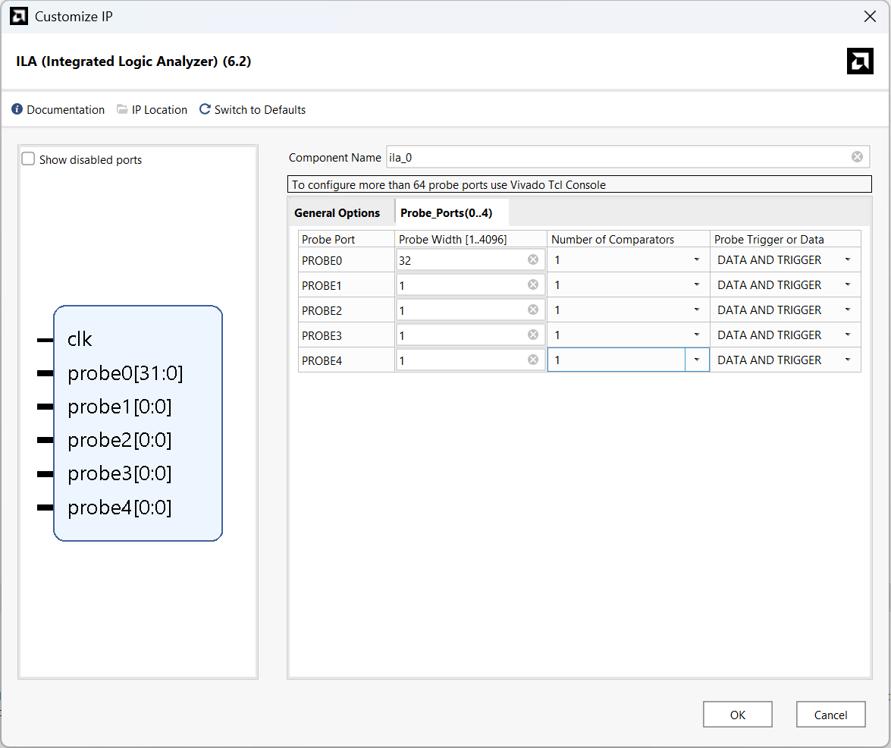
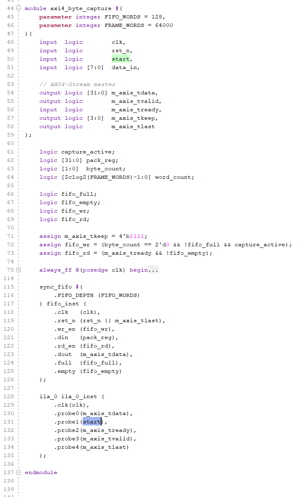
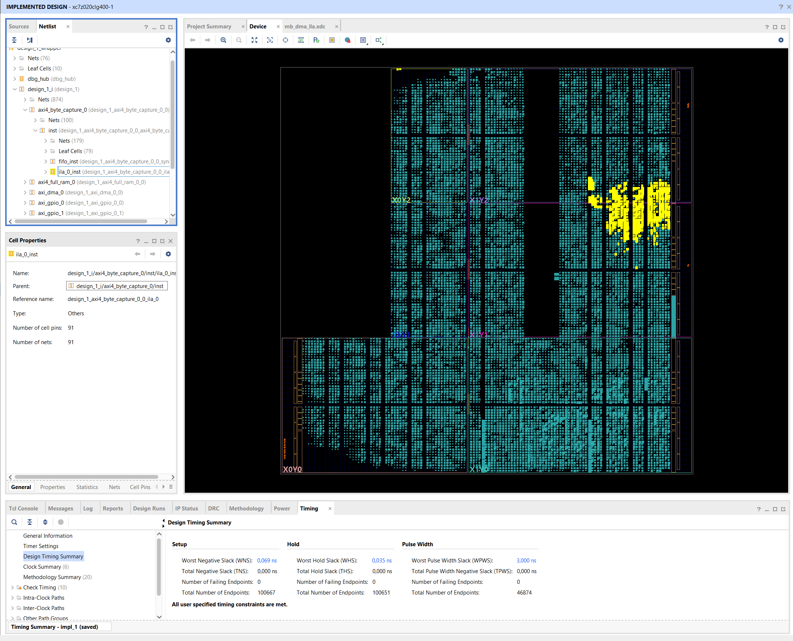

# In-System Debug

## Reproduction Steps

The project from `homework_5` was used to demonstrate in-system debug features:
- Open [mb_dma.xpr](../homework_5/vivado/mb_dma/mb_dma.xpr) with Vivado
- Run `Reports -> Report IP status` and check if all components are up-to-date
- Run synthesis/implementation/generate bitstream

## Description

Variation B of the task was selected due to the unavailability of a physical development board.

ILA IP was reconfigured for 5 probes (32-bit output data and 4 control i/o signals of `axi_byte_capture` module)

This was done as a part of `axi_byte_capture` IP using `Re-customize IP` feature of Vivado.

ILA instance was added to [axi_byte_capture.sv](../homework_5/vivado/axi4_byte_capture/axi4_byte_capture.sv) file:

Project successfully passed synthesis, implementation and generate bitstream phases:

