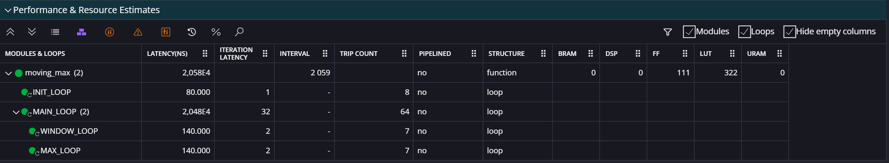
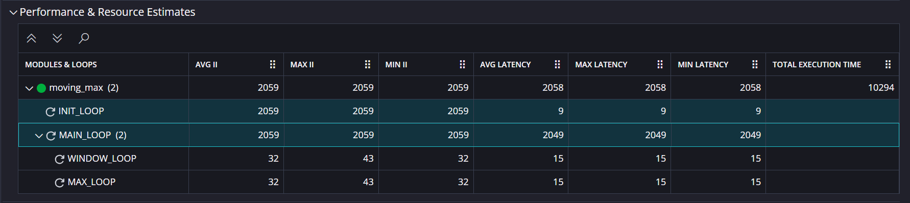
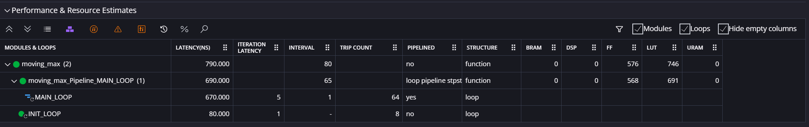
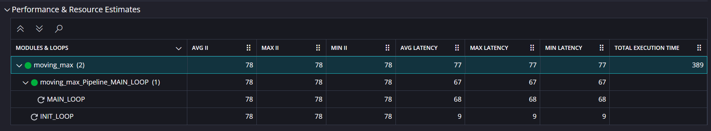
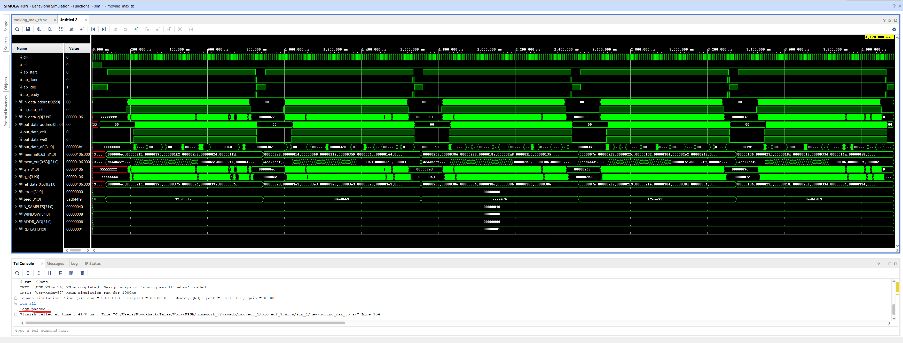

# High-Level Synthesis

## Reproduction Steps

- Open Vitis IDE and import (`File -> Import`) [archive.zip](vitis/archive.zip) into the same folder similar to the way described in [homework_4](../homework_4/readme.md)
- Comment out line 19 (with pragma) of [moving_max.cpp](vitis/src/moving_max.cpp)
- Run `C Simulation` and `C Synthesis` and observe the following results
    
- Run `C/RTL Cosimulation` and observe the following results:
    
- Revert back all changes in [moving_max.cpp](vitis/src/moving_max.cpp)
- Run `C Simulation` and `C Synthesis` and observe the following results
    
- Run `C/RTL Cosimulation` and observe the following results:
    
- Run `Package`
- Open [project_1.xpr](vivado/project_1/project_1.xpr) with Vivado
- Run `Reports -> Report IP status` and update outdated IP
- Find `moving_max_0` IP in `Design Sources` and run `Reset Output Products`/`Generate Output Products` on it
- Run behavioral simulation and observe the following results:
    

## Description

Moving Max algo was implemented in C with HLS feature. 

Feature allows to build IP's written in C language and connect it to HDL projects.

Algo was tested in 2 enviroments (C and HDL):
- C testbench [moving_max_tb.cpp](vitis/src/moving_max_tb.cpp)
- System Verilog testbench [moving_max_tb.sv](vivado/project_1/project_1.srcs/sim_1/new/moving_max_tb.sv)
